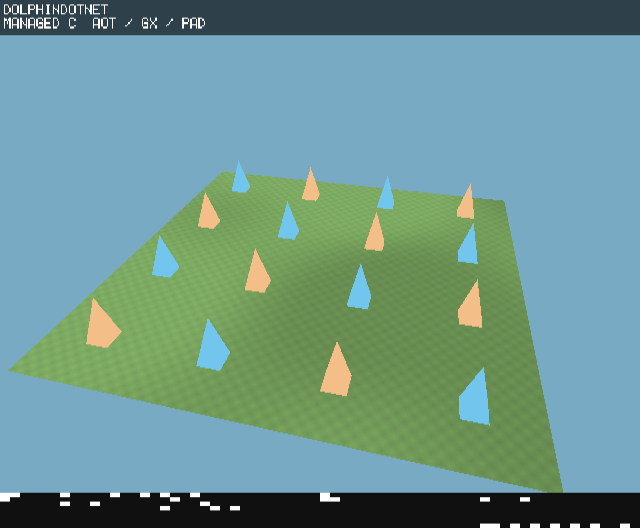

# Exact indexed geometry cache

`IndexedMeshCache` retains a native immutable mesh keyed by content revision and
used vertex/index counts. A cache hit reads no geometry, allocates nothing and
performs no native upload. A miss copies only the supplied prefixes through the
existing SDK range API. The caller owns the arrays and must change the revision
when positions, normals, colors, UVs or topology change. Commit/dispose between
frames. Failed creation preserves the previous mesh and revision.

The existing `DynamicMeshBuffer` already skips unchanged revisions. This helper
adds shared indexed vertices and exact used ranges rather than padding/drawing
capacity. Keep `DynamicMeshBuffer` for frequently animated vertex data: a dirty
indexed cache replaces an immutable native mesh instead of updating it in place.

The rendering fixture now authors the 16x16-cell ground as 289 shared grid
vertices and 1,536 indices, preserving 512 triangles and winding. Its native
vertex/index payload falls from 55,296 to 13,476 bytes (75.6%). Managed decode
arrays fall from 36,864 to 13,476 data bytes. The frame-120 color edit now edits
one shared vertex, so both adjacent triangles receive that authored color.
The revision changes exactly once; the expected two uploads are unchanged.

This is a storage/upload-path improvement, not a measured engine frame-time
claim. The separate DolphinDotNet color-index PR accelerates neutral-tint unlit
meshes; this engine helper also works on the existing pinned SDK. Nonwhite
varying-color tint continues to use the SDK's exact fallback.

`tests/Hypercube.GameCube.Tests` links the adapter to a small fake native boundary
to check prefix sizes, revision/count invalidation, zero-allocation cache hits,
failed creation and disposal. It is run by `tools/build_validation.sh`. Existing
asset/scheduler/rendering core checks pass. The actual Rendering DOL is compiled
and linked with the source SDK, with native telemetry validating geometry,
material groups, cloud states, bounded allocations and dirty upload counts.

The completed native run passes the strict rendering validator: 327 decoded
telemetry samples, all three cover states, exactly two dirty uploads, at most two
material batches/three API calls, and 576 triangles. It sustains progress beyond
the validator's frame-540 threshold and retirement checks. The first 40-second
capture reached only frame 450 while other build work was active; the final
75-second capture ran serially and was decoded with host FFmpeg. This is native
correctness/progress evidence, not a frame-time comparison.
[Result and source/DOL identity](measurements/indexed-cache/results.json).

